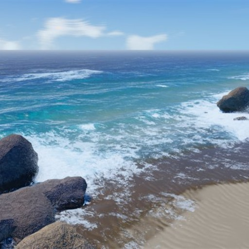

# NeuralSpecOcean for Wallpaper Engine

[繁體中文](#繁體中文) | [English](#english)



> 這個資料夾是在 [NeuralSpecOcean](https://github.com/bgbg108555/NeuralSpecOcean) 的 fork 裡加上的 **非官方** Wallpaper Engine 移植。海洋模擬本體來自原作（bgbg108555 與 NeuralSpecOcean Contributors，MIT 授權）；本資料夾只加上桌布設定與功能，與原作者、Wallpaper Engine 官方皆無關聯。
>
> This folder is an **unofficial** Wallpaper Engine port added in a fork of [NeuralSpecOcean](https://github.com/bgbg108555/NeuralSpecOcean). The simulation is the upstream work (bgbg108555 and NeuralSpecOcean Contributors, MIT). Not affiliated with the upstream author or with Wallpaper Engine.

---

## 繁體中文

### 功能

- **日夜**：跟隨電腦時間、自訂長度的日夜循環、或固定時間；時間大幅變化時會在數秒內平順過渡，不會跳轉
- **鏡頭**：五種視角；鏡頭只在正面範圍擺動，不會轉到背面，可選水平移動、八字形、繞圈（各有反向）
- **滑鼠**：視角跟隨游標輕微偏移（可調幅度、可反轉）；可開關拖曳旋轉與滾輪縮放
- **海水與海浪**：五種海水配色、色調、深淺、清澈度、地形、浪高、浪花
- **其他**：畫質、海浪音效音量、支援 Wallpaper Engine 的 FPS 上限與暫停、診斷資訊

### 安裝

1. 下載 Release 的 zip，或下載這個 repo。
2. 把 `wallpaper-engine/wallpaper` 資料夾複製到
   `Steam\steamapps\common\wallpaper_engine\projects\myprojects\`（可改名，例如 `NeuralSpecOcean`）。
3. 重新開啟 Wallpaper Engine，在清單中選用。第一次載入需編譯著色器，約 15–30 秒。

需求：支援 WebGL2 的顯示卡。筆電或內顯建議把畫質設為「極速」或「低」。各設定說明見 [`wallpaper/使用說明.txt`](./wallpaper/使用說明.txt)。

### 重建 `wallpaper/index.html`

`wallpaper/index.html` 是由 repo 根目錄的 `index.html`（原作的單檔版）產生的，只插入四行（見 [CHANGES.md](./CHANGES.md)）。同步原作的更新後，在 repo 根目錄執行：

```powershell
powershell -ExecutionPolicy Bypass -File wallpaper-engine\tools\build.ps1
```

本機預覽：

```powershell
powershell -ExecutionPolicy Bypass -File wallpaper-engine\tools\preview-server.ps1 -Root wallpaper-engine\wallpaper -Port 8765
```

然後開啟 http://localhost:8765/。

### 授權

- 與原作相同，以 MIT License 釋出；原作授權見 repo 根目錄的 [LICENSE](../LICENSE)，本資料夾的授權與著作權聲明見 [`wallpaper/LICENSE.txt`](./wallpaper/LICENSE.txt)。
- 第三方元件（Three.js、NASA 星圖）見 [`wallpaper/THIRD_PARTY_NOTICES.md`](./wallpaper/THIRD_PARTY_NOTICES.md) 與根目錄的 [THIRD_PARTY_NOTICES.md](../THIRD_PARTY_NOTICES.md)。
- 散布或上傳到 Steam Workshop 時，請保留 `wallpaper` 資料夾內的 `LICENSE.txt`、`THIRD_PARTY_NOTICES.md`、`THREE_LICENSE.txt`，並註明原作 NeuralSpecOcean。

---

## English

### Features

- **Day/night**: follow the PC clock, a day cycle of configurable length, or a fixed time; large time changes ease over a few seconds instead of jumping
- **Camera**: five viewpoints; the camera only swings across the front of the scene (never to the back): horizontal, figure eight or circle, each with a reverse variant
- **Mouse**: view leans toward the cursor (adjustable, invertible); drag/zoom interaction can be turned off
- **Water**: five palettes, tint, depth, clarity, terrain, wave height, foam
- **Other**: quality presets, ocean sound volume, Wallpaper Engine FPS limit and pause support, diagnostics overlay

### Install

Copy `wallpaper-engine/wallpaper` into `Steam\steamapps\common\wallpaper_engine\projects\myprojects\`, restart Wallpaper Engine and select it. First load compiles shaders (about 15–30 s). Needs a WebGL2-capable GPU.

### Rebuild

`wallpaper/index.html` is generated from the repository's root `index.html` (the upstream standalone build) with four insertions listed in [CHANGES.md](./CHANGES.md). After syncing the fork with upstream, run from the repository root:

```powershell
powershell -ExecutionPolicy Bypass -File wallpaper-engine\tools\build.ps1
```

### License

MIT, like upstream. Upstream license: [LICENSE](../LICENSE). This folder: [`wallpaper/LICENSE.txt`](./wallpaper/LICENSE.txt). Third-party notices: [`wallpaper/THIRD_PARTY_NOTICES.md`](./wallpaper/THIRD_PARTY_NOTICES.md). Keep those files when redistributing (including Steam Workshop) and credit NeuralSpecOcean.
